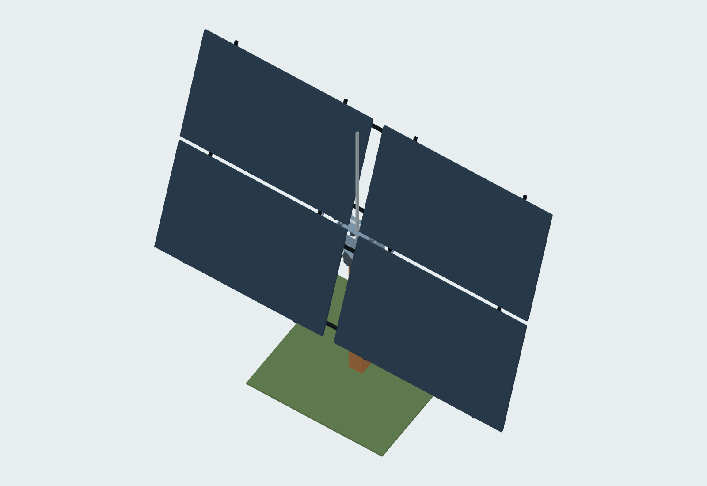
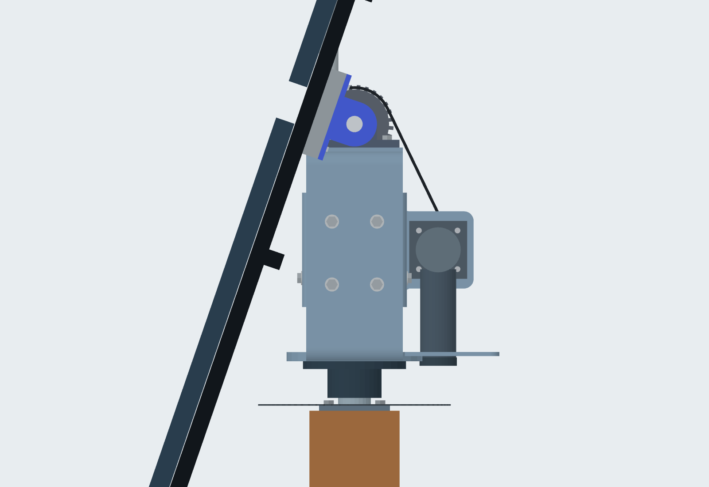

# Four-Panel Solar Tracker

A hardware concept for a two-axis tracker built around four owned solar panels, an upright trailer spindle and hub, a fabricated steel bearing bracket, and an aluminum square-tube panel frame.

**This is an early CAD and layout study.** The panels and trailer hub kit are owned or selected, but the tracker has not been built or load-tested. The shaft, bearings, motor, sprockets, chain, frame sections, fasteners, and most mounting details remain provisional.

## Current layout

- Four panels arranged in two rows and two columns. Each panel is 45 × 68 in, with the 68-in side horizontal. The exact panel model and mass have not been recorded yet.
- Clear gaps are 120 mm between columns and 60 mm between rows. The row gap is based on two panel clamps that each extend 30 mm from the panel edge to the back of the clamp.
- Four continuous vertical aluminum square tubes and four horizontal rails support the panels. The model uses 25.4 mm outside dimensions as a starting proxy; wall thickness and connection details are open.
- A nominal 1-in tilt shaft runs across the frame. Custom moving shaft-clamp proxies sit 720 mm apart, with two support bearings 320 mm apart inside them.
- The array's viewing faces point upward at Wind 0°. Winter 71° is the Tacoma winter-facing layout position. These are preview positions, not verified operating limits.

The render shows the four-panel array, continuous frame rails, mast, and raised pivot bracket in the current winter layout.

## Pivot bracket and tilt drive

The main pivot is a trailer hub and upward-facing spindle mounted in a ground-set 6×6 post. A round steel interface plate sits on the hub. The current bracket concept raises two bearing pads above that plate, with bolt-on side gussets and two mast bridge plates.

A provisional right-angle geared motor attaches to the inside face of one bracket riser. Its body hangs downward and its output shaft passes outward through the motor plate. A 12-tooth motor sprocket drives a 28-tooth sprocket on the tilt shaft with a bicycle-chain loop. The preview places that drive between one support bearing and the moving frame clamp.

A separate large sprocket is shown at the fixed spindle flange for a future pan drive. The pan preview is limited to 180° total travel.

## Interactive model

[Open the interactive four-panel assembly viewer](assembly-viewer.html). Use **Winter 71°**, **Wind 0°**, or the tilt slider to change the panel position. The View list controls visible assemblies, and the bill of materials lists modeled parts and quantities. The **Tilt drive** view focuses on the provisional motor and chain arrangement.

The accompanying [OpenSCAD shape study](azimuth-post-spindle.scad) is editable. Dimensions and simplified geometry are recorded as design inputs, not fabrication drawings.

## Modeled bill of materials

| Assembly | Modeled quantity | Current status |
| --- | ---: | --- |
| 45 × 68-in solar panels | 4 | Owned; exact model and mass pending |
| 6×6 post and trailer hub/spindle | 1 each | Hub kit selected; installation and load path unverified |
| Bent hub and bearing bracket | 1 | Shape study; dimensions and strength unverified |
| Bolt-on side gussets | 2 | Provisional steel plates |
| Tilt support bearings | 2 | Not purchased |
| 1-in tilt shaft | 1 | Planned size; not purchased or checked for strength/deflection |
| Custom moving shaft clamps and spacers | 2 each | Geometry proxies; fastening not designed |
| Aluminum square-tube frame | 8 members | 25.4-mm outside-size proxy; wall and joints open |
| Right-angle tilt gearmotor | 1 | Placeholder; no motor selected |
| Tilt sprockets and chain | 2 sprockets, 1 loop | Provisional 12/28 tooth layout; chain details open |
| Fixed pan sprocket | 1 | Placeholder mounted at spindle flange |
| Wind mast and bridge plates | 1 mast, 2 plates | Placeholder; mast size and sensor selection open |

## Design status and next work

This model helps review layout and component relationships. It does not establish structural capacity, wind survival, actuator torque, bearing life, foundation adequacy, or safe operating limits.

Before fabrication, the design needs the exact panel data, measured hub and spindle interfaces, chosen bearings and shaft, selected motors and chain, actual aluminum tube sections, complete fastener patterns, and load calculations for the panels, bracket, post, and foundation. The 60-mm panel-clamp seam and the modeled clearances also need confirmation against the physical hardware.
