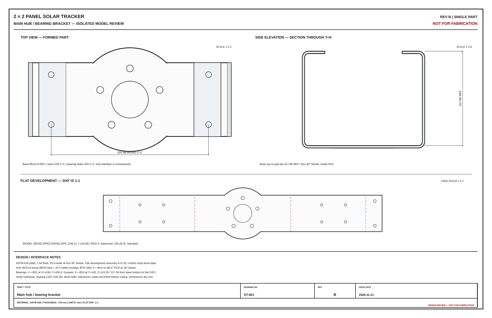
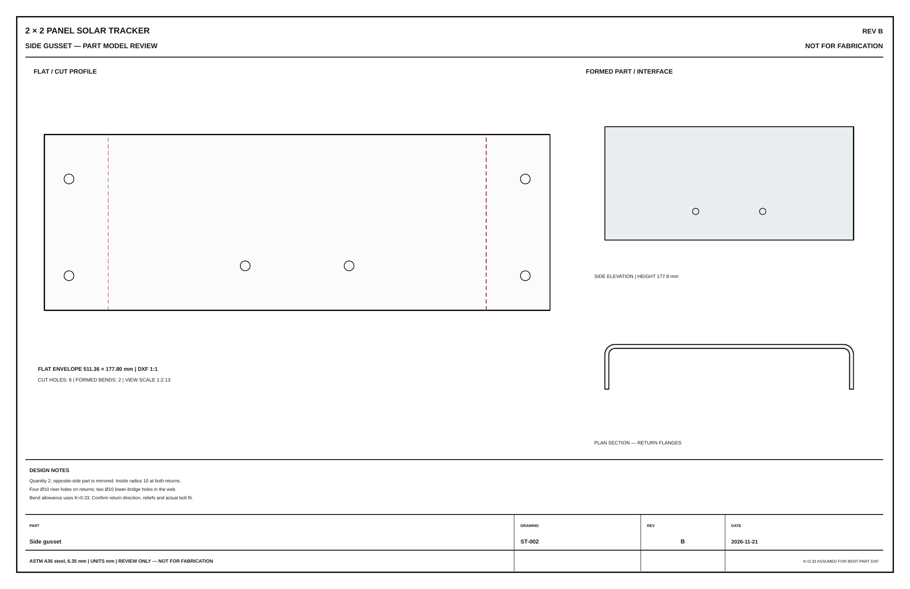
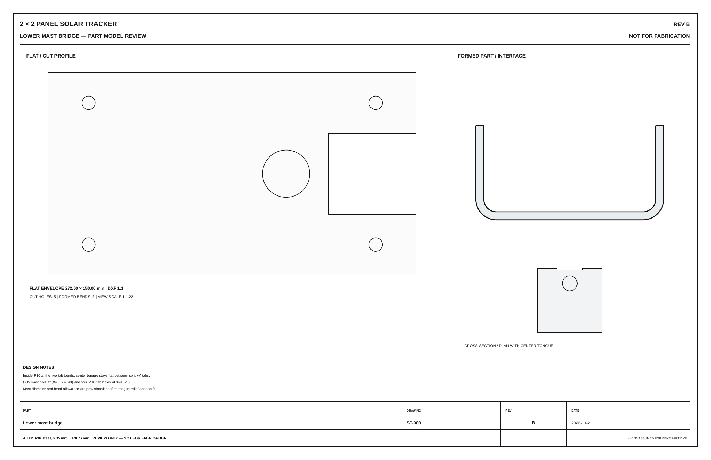
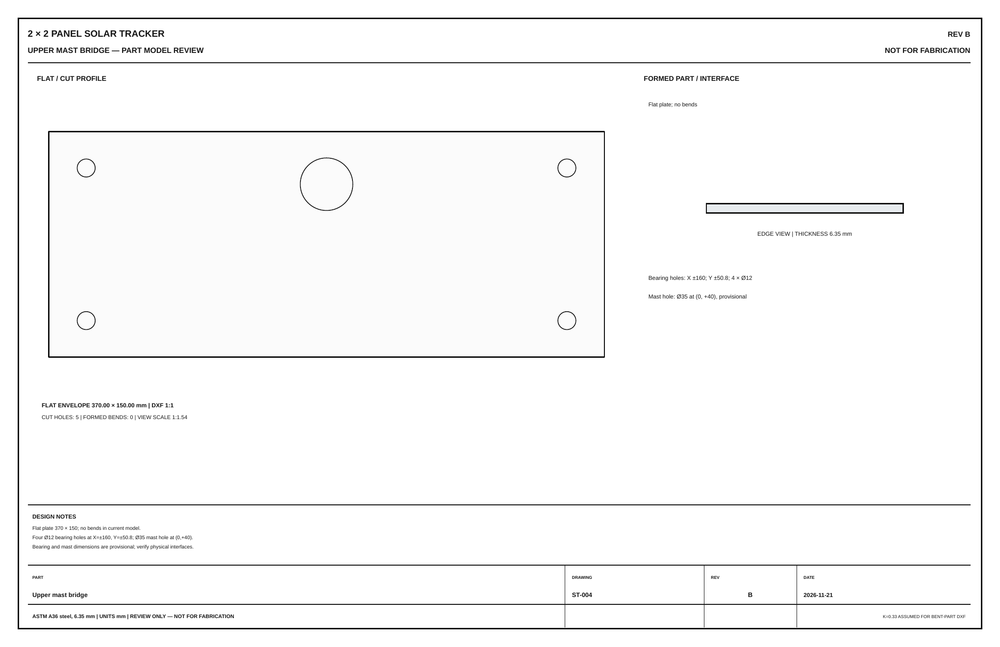
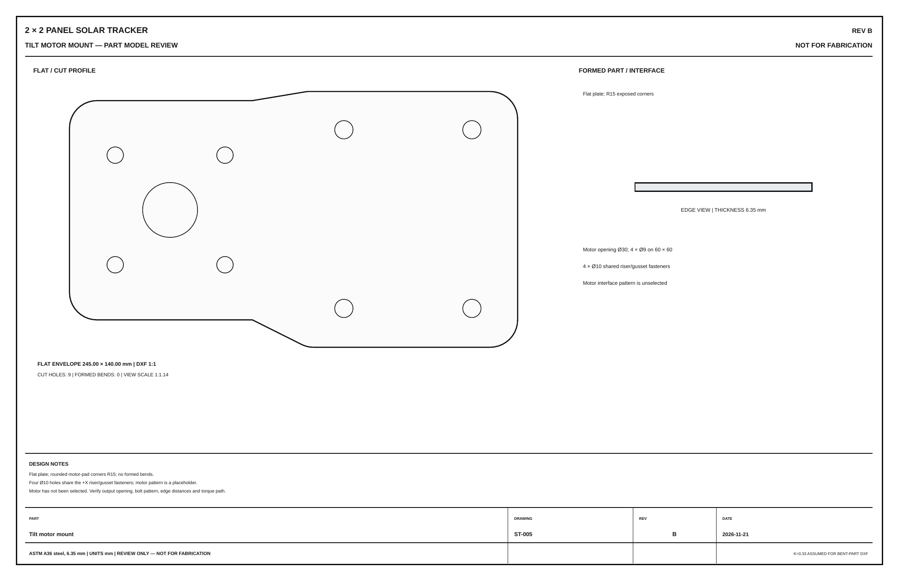
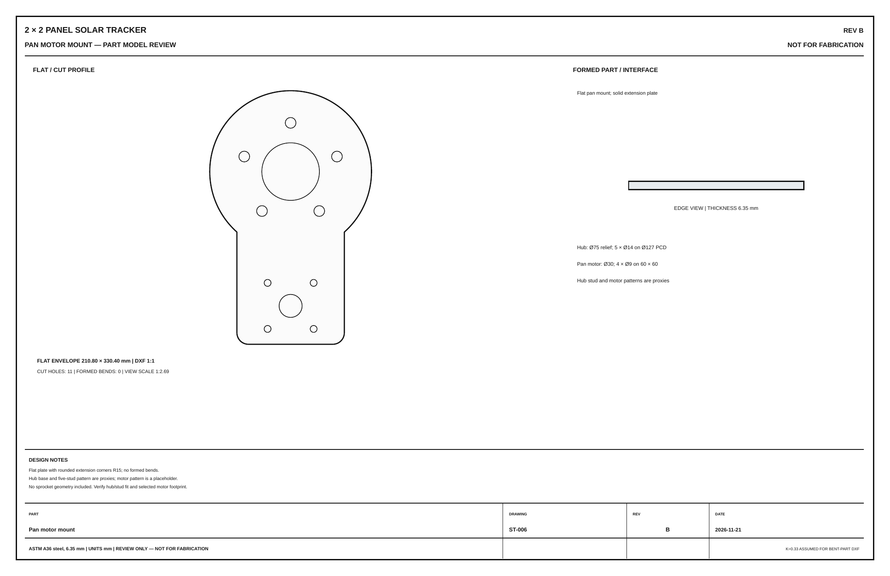

# Solar tracker sheet-metal package — Rev B

This folder contains six individual design-review drawings and their matching flat-pattern DXFs.

- `drawings/` — one-sheet PDF drawing per part, with flat and formed views where applicable.
- `dxf/` — 1:1 flat profiles in millimeters. The closed perimeter and holes are on `CUT`; bend centerlines use separate `BEND`, `BEND_A`, or `BEND_B` layers as applicable.
- `previews/` — full-page PNG previews embedded below for scrolling review.

## Drawing previews

### ST-001 — Main hub / bearing bracket

### ST-002 — Side gusset

### ST-003 — Lower mast bridge

### ST-004 — Upper mast bridge

### ST-005 — Tilt motor mount

### ST-006 — Pan motor mount

## Review status

These files are for design review only and are marked **NOT FOR FABRICATION**. The DXFs preserve the current Rev B flat geometry and use a complete DXF document structure based on the CPC Backbone SendCutSend example. Their local structure and cut geometry were checked, but they have not been uploaded to SendCutSend; shop import and formed previews are unconfirmed.

The drawings identify provisional materials and thicknesses. The bent-part DXFs use an assumed K-factor of 0.33, and the hub, bearing, mast, and motor interfaces still include unmeasured or unselected proxies. Confirm material, bend setup, dimensions, interfaces, and structural design before fabrication.
